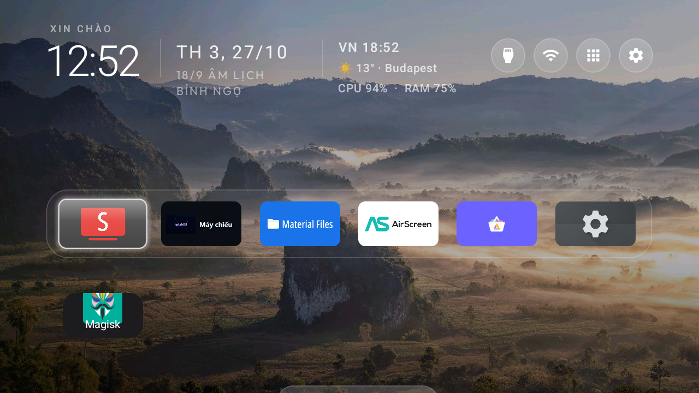

# HY300 Ultra (Gojodoq / Magcubic) - Allwinner H726 - Root, Reverse-Engineering & Customization

*Maintained by [hoangphi01](https://github.com/hoangphi01). Built on the XDA H726 root guide and the H713 research base, with [Claude](https://www.anthropic.com/claude) (Anthropic's AI) used as a research assistant.*

**English** · [Tiếng Việt](README.vi.md)

-blue)

---

> **Downloads (prebuilt):** the rooted image, the stock firmware (for unbrick) and the APKs are mirrored on **[MEGA](https://mega.nz/folder/5UgxwQiS#EcKh5wCWni6yjOcDvCLXvQ)** - H726 only; verify the SHA256 listed in the folder. You can flash them directly instead of building, see [02. Rooting](docs/02-rooting.md).

## 1. Overview

This repository is the engineering record and all-in-one archive for the **Gojodoq / Magcubic HY300 Ultra** projector platform, powered by the **Allwinner H726 SoC (`sun50iw15p1`, FEL id `0x1911`)**. The HY300 Ultra is a cheap cylindrical Android 14 projector sold white-label under several brands on one common board; its stock firmware is a locked-down clone carrying ad/tracker bloat and a BadBox-family backdoor.

The work spans the complete stack: FEL / BootROM entry, a minimal-diff rooted IMAGEWTY built around the firmware's **`add_sum` verify-file checksums**, jadx/`strings` reverse-engineering of the **keystone / auto-keystone / autofocus subsystem**, **BadBox 2.0** malware teardown and neutralization, and a full post-root software rebuild.

It is written to **complement, not replace, the existing [XDA H726 root guide](https://xdaforums.com/t/guide-rooting-tutorial-for-a-magcubic-hy300-pro-with-an-allwinner-h726-and-android-14.4776519/)**: that guide covers flashing; this documents what it does not - the checksum detail that actually makes a custom image flash, the internals of the display/keystone system, the malware teardown, and the customization. Everything is specific to the **H726**; H713 owners are redirected in the [Compatibility](#6-compatibility) section.

## 2. Device Specifications

- **SoC:** Allwinner H726 (`sun50iw15p1`), FEL SoC id `0x1911`, FEL USB `1f3a:efe8`
- **CPU:** Quad-core ARM Cortex-A53 (an ARMv8-A, 64-bit-capable core, but **run in 32-bit / AArch32 mode**: the firmware ships a 32-bit kernel and an `armeabi-v7a`-only userspace, almost certainly to save RAM on this ~1 GB device. Tools like AIDA64 read the core ID and report "ARMv8-A", which is the silicon; the running ABI is 32-bit)
- **GPU:** ARM Mali-G31 (OpenGL ES 3.2, driver `r20p0`; from SurfaceFlinger on this unit)
- **RAM:** ~1 GB (low-RAM device; `ActivityManager.isLowRamDevice = true`)
- **Storage:** eMMC (`/dev/block/mmcblk0`); total capacity not precisely measured on this unit
- **Gravity sensor:** MPU-6880 (drives auto-keystone; reports z < 0 when inverted)
- **Display:** 720p native (`1280x720`), LED projector optics
- **Wireless:** Wi-Fi + Bluetooth via an **AIC (Aicsemi AIC8800-family)** combo chip (`rwnx` driver, `persist.log.tag.wlan_vendor = aic`); the exact 802.11 standard and bands are **not confirmed**
- **Operating System:** Android 14 (API 34), Magcubic build `Projector_20250806.111734`
- **Userspace ABI:** 32-bit `armeabi-v7a` (many 64-bit-only / Play-certified APKs will not install)
- **Partition Layout:** A/B slots with `init_boot`, dynamic `super`; `verifiedbootstate = orange`, verity disabled; per-unit colour/keystone calibration lives on a reserve partition that stock flashing skips
- **Identity strings:** `ro.product.model = ADT-3`, `ro.product.board = h726-p2`, retail aliases HY300 Ultra / Pro / Plus / MAX (the Wi-Fi AP name defaults to `HY300 Ultra Pro Max`), retail SKU `AC1076`

> Specifications were obtained by **software probing + FEL**, not a board teardown. The GPU (Mali-G31) and the Wi-Fi/BT family (AIC) are read from the running system; the **PMIC, audio amp, exact Wi-Fi model / 802.11 standard, eMMC size and kernel version are not yet confirmed** - contributions from a teardown are welcome.

## 3. The story: from registers to the install image

Rooting this box was not one clean exploit; it was a week of dead-ends, and the dead-ends are the most useful part to pass on.

**The wall.** Every public tool for these projectors - sunxi-fel, U-Boot, the root guides - targets the **H713 (`sun50iw12`, FEL `0x1860`)**. This unit answered FEL with `soc=00001911(unknown)`: a *newer* SoC, `sun50iw15`, with no BSP, no FEL port, no U-Boot anywhere. The usual commands connected and then simply hung.

**Down at the register level.** So the first days were spent one register at a time. Scripts in [`scripts/`](scripts) scanned the BootROM for the **RVBAR** reset-vector address, disassembled the mask ROM looking for the **RMR** write that flips the core between AArch32 and AArch64, and hunted the load address the SoC expects for the first-stage **`fes1`** blob. Every H713 constant was tried and every one hung on an "unexpected `SCTLR`". The breakthrough at this layer was small and specific: the stock **`fes1.fex` loads to SRAM `0x0010C000`**, and the vendor U-Boot has an ARM32 self-switching head, so it needs **no** external RVBAR jump at all - the very thing the H713 flow forces, and the reason it kept hanging. With that, FEL finally brought up DRAM and ran a bootloader.

**The real blocker was not a register - it was the install image.** With a way in, the plan was simple: patch Magisk into `init_boot`, flash, done. PhoenixSuit rejected every image with a flat *"firmware file is valid"* error. Hex-editing the `IMAGEWTY` in place - `init_boot`, `vbmeta`, `dlinfo`, `sys_partition` - only made it worse. The container keeps **per-partition `add_sum` verify-files**: a tiny `V<name>.fex` holding a `u32` checksum (pad to x4, sum every little-endian word). Change a payload and that checksum no longer matches, so the flasher refuses the whole image. The fix that finally produced root was to stop editing in place and instead **swap whole payloads and recompute their verify-files** - a byte-for-byte copy of stock with only the Magisk `init_boot` and a verity-off `vbmeta` replaced, and their two `add_sum` checksums rewritten. PhoenixSuit accepted it; `su` returned `uid=0`.

**After root, the work turned inward.** Root was the means, not the end. The same decompile-and-probe habit went into the **display stack**: tracing why auto-keystone kept skewing led through two separate keystone code paths and a gravity-sensor sign bug, and ended at a one-line realization about device orientation (Section 5 links the write-up). The same curiosity found a **setuid-root backdoor** sitting in `/system/xbin` and the fake Play Store next to it. And then the fun part - rebuilding the home screen into something worth looking at.

Each of those threads has its own write-up in the [Documentation Index](#5-documentation-index), with the mistakes left in.

## 4. Results & Milestones

- [x] **Root** on H726 / sun50iw15 - `adb shell su` returns `uid=0(root) ... u:r:magisk:s0`. To our knowledge the **first publicly documented** root of this SoC in an HY300-class projector.
- [x] **Enabling discovery:** fixing the per-partition **`add_sum` verify-file checksum** so PhoenixSuit accepts a minimal-diff Magisk image.
- [x] **Auto-keystone fixed definitively** - root-caused to device orientation + projection mode, not any property; after one calibration the image re-squares at any tilt and survives reboot.
- [x] **Keystone / auto-keystone / autofocus subsystem reverse-engineered** - two separate keystone paths, the gravity-sensor z-axis sign bug, the real baseline store (`set_angle_offset` -> `/oem/gsensor_data`), plus a full H726-vs-H713 difference table.
- [x] **BadBox 2.0 neutralized** - removed the fake `com.android.vending` (Tubesky), OTA droppers and telemetry, and masked the `/system/xbin/hotacksu` setuid-root backdoor persistently.
- [x] **Post-root customization** - custom home screen (weather, second time zone, Vietnamese lunar date, photo-frame screensaver, three-column header), a consolidated "Hub" settings app, boot logo, timezone.
- [ ] **Open:** AirScreen for AirPlay; Private DNS ad-block; board teardown for IC-level specs; clean sunxi-fel / U-Boot port for sun50iw15.

## 5. Documentation Index

### [Hardware & rooting](docs/02-rooting.md)
Identifying the board and getting Magisk onto it:
- **[Hardware ID](docs/01-hardware-id.md):** chip identifiers, device aliases, FEL entry, H726-vs-H713 check.
- **[Rooting method](docs/02-rooting.md):** FEL + PhoenixSuit + the `add_sum` verify-file checksum fix.
- **[build_rooted_minimal.py](scripts/build_rooted_minimal.py):** builds the minimal-diff rooted image from stock firmware; SoC helpers alongside it (`find_fes1_addr.py`, `find_rmr.py`, `scan_rvbar.py`).

### [Reverse-engineering](docs/03-keystone-display.md)
Display and keystone internals of the H726:
- **[Keystone / display subsystem](docs/03-keystone-display.md):** the two keystone paths, the gsensor z-sign gotcha, baseline storage, projection-mode control, and the H726-vs-H713 table.

### [Security](docs/04-debloat-security.md)
Removing the BadBox-family malware:
- **[Debloat & BadBox removal](docs/04-debloat-security.md):** fake Play Store / Tubesky, OTA droppers, telemetry, and the `hotacksu` setuid-root backdoor.
- **[hy300tweaks (Magisk module)](magisk-module/hy300tweaks):** neutralize the backdoor on boot + force the custom launcher as HOME.
- **[restore-projector.ps1](scripts/restore-projector.ps1):** reverse the debloat (reinstall for user 0).

### [Customization](docs/05-post-root.md)
Rebuilding the software to taste:
- **[Post-root setup](docs/05-post-root.md):** launcher, Hub app, boot logo, timezone, recommended 32-bit apps.
- **[launcher-mods](launcher-mods):** the custom home-screen patch over [Gathin23/cleanyourtv](https://github.com/Gathin23/cleanyourtv).
- **[hub-app](hub-app):** `com.hy300.hub`, the consolidated settings / keystone / casting launcher.

Vietnamese reverse-engineering notes are in [`docs/vi/`](docs/vi).

## 6. Compatibility

**Is this your device?**

| | This repository (**H726**) | Not this repository (**H713**) |
|---|---|---|
| SoC | `sun50iw15p1` (H726) | `sun50iw12p1` (H713) |
| FEL SoC id | `0x1911` | `0x1860` |
| Display pipeline | DRM/KMS direct (no MIPS) | MIPS co-processor (`display.bin`) |
| Gravity sensor | MPU-6880 | SC7A20 |

**Check yours:** `adb shell getprop ro.hardware` should print `sun50iw15p1`; in FEL mode `sunxi-fel version` should print `soc=00001911`. Full method: [docs/01](docs/01-hardware-id.md).

If you see `sun50iw12` / `0x1860`, this is an **H713** - use the projects this work is built on instead: [YuujiLab/HY300-H713-Research](https://github.com/YuujiLab/HY300-H713-Research), [probonopd/hy310-deshittify](https://github.com/probonopd/hy310-deshittify), and the [H713 XDA thread](https://xdaforums.com/t/beta-android-tv-and-root-tutorial-for-allwinner-h713-based-projectors.4744020/).

## 7. Disclaimer & Liability

- **User Responsibility.** Flashing an Allwinner device can permanently **brick** it. You alone are responsible for your hardware and for complying with local law.
- **No Warranty.** This material is provided "as is", without warranty or support of any kind.
- **H726 Only.** These procedures target the H726 (`sun50iw15` / `0x1911`). Do **not** apply them to an H713 or any other SoC (see Section 6).
- **Malware Notice.** The stock firmware is a white-label clone historically tied to **BigDroidOS / Bigpanzi** and flagged with **BadBox 2.0**. This repo shows how that was found and neutralized, but a cloned firmware can never be fully trusted: do **not** sign into personal, banking or Google accounts on it, and keep it network-isolated.
- **No Redistribution.** No proprietary firmware, APKs or vendor libraries are included here; only original work is. Firmware is linked to its source, not hosted.

## 8. Acknowledgments & References

This work builds on, and is grateful to:

- the **XDA H726 rooting guide** - [*Rooting tutorial for a Magcubic HY300 Pro (Allwinner H726, Android 14)*](https://xdaforums.com/t/guide-rooting-tutorial-for-a-magcubic-hy300-pro-with-an-allwinner-h726-and-android-14.4776519/);
- the **H713 research base** - [YuujiLab/HY300-H713-Research](https://github.com/YuujiLab/HY300-H713-Research), [probonopd/hy310-deshittify](https://github.com/probonopd/hy310-deshittify), well0nez's sunxi-tools / Linux port and keystone model, [gniax/magcubic-hy300-root](https://github.com/gniax/magcubic-hy300-root), [schaumann-byte/hy300-projector-homeassistant](https://github.com/schaumann-byte/hy300-projector-homeassistant);
- the **BadBox removal reference** - [maximilian-sh/hy350max-badbox-removal](https://github.com/maximilian-sh/hy350max-badbox-removal);
- and **[Claude](https://www.anthropic.com/claude) (Anthropic's AI), used as a research assistant** throughout. Claude assisted as a tool and is **not** a git co-author; the repository owner made the decisions, took the risks and ran the hardware.

**Guides** - [H726 root (XDA)](https://xdaforums.com/t/guide-rooting-tutorial-for-a-magcubic-hy300-pro-with-an-allwinner-h726-and-android-14.4776519/) · [H713 root (XDA)](https://xdaforums.com/t/beta-android-tv-and-root-tutorial-for-allwinner-h713-based-projectors.4744020/)
**Tools** - [Magisk](https://github.com/topjohnwu/Magisk) · [sunxi-tools](https://github.com/linux-sunxi/sunxi-tools) · [OpenixSuit](https://github.com/YuzukiTsuru/OpenixSuit) · [imagewty-tool](https://github.com/uictorius/imagewty-tool) · [MagiskPatcher](https://circlecashteam.github.io/MagiskPatcher/) · [jadx](https://github.com/skylot/jadx) (Apache-2.0) · PhoenixSuit (Allwinner)
**Post-root software** - [cleanyourtv launcher](https://github.com/Gathin23/cleanyourtv) (MIT) · [SmartTube](https://github.com/yuliskov/SmartTube) · [Material Files](https://github.com/zhanghai/MaterialFiles) · Aurora Store · [Lucide icons](https://github.com/lucide-icons/lucide) · [Open-Meteo](https://open-meteo.com) · Outfit font (OFL)
**Firmware** (linked, not redistributed) - androidpctv.com · magcubic-support.com. Launcher-theme wallpaper photos are CC-BY / CC-BY-SA / CC0 by their authors (see the theme's `CREDITS.md` upstream).

## 9. License

[MIT](LICENSE) for the original work in this repository. It does **not** cover the upstream projects (each keeps its own license) or any proprietary vendor firmware / APKs / libraries, which are **not** included here. See the scope note in [LICENSE](LICENSE).

---

*Not affiliated with Allwinner, Magcubic, Gojodoq, Google or Anthropic.*
