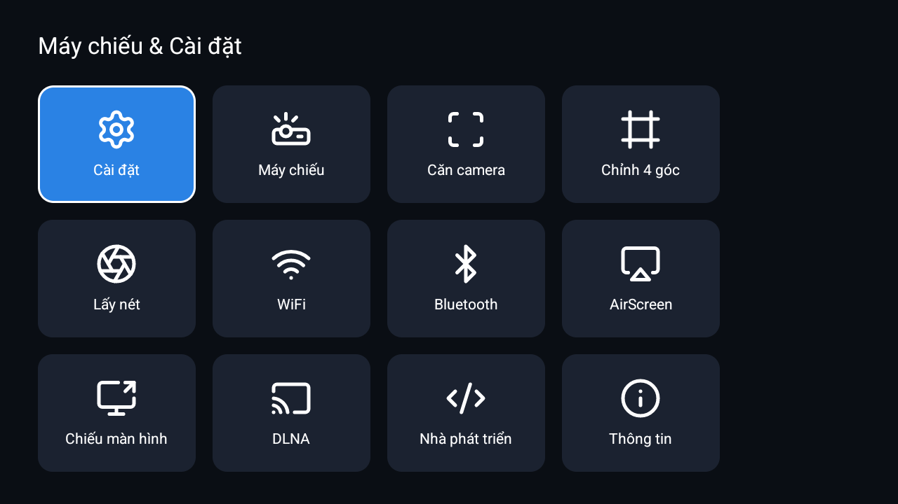

# HY300 Ultra (Gojodoq / Magcubic) - Allwinner H726 - Root, Dịch ngược & Tùy biến

*Thực hiện bởi [hoangphi01](https://github.com/hoangphi01). Dựa trên guide root H726 trên XDA và nền research H713, với [Claude](https://www.anthropic.com/claude) (AI của Anthropic) làm trợ lý nghiên cứu.*

[English](README.md) · **Tiếng Việt**

-blue)

 

Trái: màn hình chính dựng lại (thời tiết, đồng hồ thứ hai, âm lịch, screensaver khung tranh). Phải: app "Hub" gom các cài đặt rải rác của hãng (keystone, lấy nét, casting, Wi-Fi, developer) vào một màn.

---

> **Tải về (bản dựng sẵn):** image đã root, firmware stock (để unbrick) và các APK được mirror trên **[MEGA](https://mega.nz/folder/5UgxwQiS#EcKh5wCWni6yjOcDvCLXvQ)** - chỉ cho H726; nhớ verify SHA256 ghi trong folder. Có thể flash thẳng khỏi cần build, xem [02. Rooting](docs/02-rooting.md).

## 1. Tổng quan

Repo này là bản ghi kỹ thuật và kho all-in-one cho máy chiếu **Gojodoq / Magcubic HY300 Ultra**, chạy **Allwinner H726 (`sun50iw15p1`, FEL id `0x1911`)**. HY300 Ultra là máy chiếu Android 14 hình trụ giá rẻ, bán white-label dưới nhiều thương hiệu trên cùng một bo mạch; firmware stock là bản clone bị khóa, đầy app rác quảng cáo/theo dõi và một backdoor họ BadBox.

Công việc trải khắp stack: vào FEL / BootROM, dựng image root minimal-diff xoay quanh **checksum `add_sum` trong V-file** của firmware, dịch ngược bằng jadx/`strings` **subsystem keystone / auto-keystone / autofocus**, bóc và vô hiệu malware **BadBox 2.0**, và dựng lại toàn bộ phần mềm hậu-root.

Repo viết để **bổ sung, không thay thế [guide root H726 trên XDA](https://xdaforums.com/t/guide-rooting-tutorial-for-a-magcubic-hy300-pro-with-an-allwinner-h726-and-android-14.4776519/)**: guide đó lo phần flash; repo này ghi phần nó không có - chi tiết checksum khiến image tùy biến flash được, ruột hệ hiển thị/keystone, bóc malware, và tùy biến. Tất cả đặc thù cho **H726**; máy H713 xem mục [Tương thích](#6-tương-thích).

## 2. Thông số thiết bị

- **SoC:** Allwinner H726 (`sun50iw15p1`), FEL SoC id `0x1911`, FEL USB `1f3a:efe8`
- **CPU:** ARM Cortex-A53 4 nhân (lõi ARMv8-A, **có khả năng 64-bit nhưng chạy ở chế độ 32-bit / AArch32**: firmware dùng kernel 32-bit và userspace chỉ `armeabi-v7a`, gần như chắc chắn để tiết kiệm RAM trên máy ~1 GB. Công cụ như AIDA64 đọc mã lõi nên báo "ARMv8-A" - đó là phần cứng; còn ABI đang chạy là 32-bit)
- **GPU:** ARM Mali-G31 (OpenGL ES 3.2, driver `r20p0`; đọc từ SurfaceFlinger trên máy này)
- **RAM:** ~1 GB (thiết bị low-RAM; `ActivityManager.isLowRamDevice = true`)
- **Lưu trữ:** eMMC (`/dev/block/mmcblk0`); chưa đo chính xác dung lượng trên máy này
- **Cảm biến trọng lực:** MPU-6880 (điều khiển auto-keystone; báo z < 0 khi úp ngược)
- **Màn hình:** 720p gốc (`1280x720`), quang học LED
- **Không dây:** Wi-Fi + Bluetooth qua chip combo **AIC (Aicsemi dòng AIC8800)** (driver `rwnx`, `persist.log.tag.wlan_vendor = aic`); chuẩn 802.11 và băng tần chính xác **chưa xác nhận**
- **Hệ điều hành:** Android 14 (API 34), build Magcubic `Projector_20250806.111734`
- **Userspace ABI:** 32-bit `armeabi-v7a` (nhiều APK 64-bit / Play-cert sẽ không cài được)
- **Phân vùng:** A/B slot với `init_boot`, `super` động; `verifiedbootstate = orange`, verity tắt; calibrate màu/keystone theo máy nằm ở partition reserve mà flash stock bỏ qua
- **Chuỗi định danh:** `ro.product.model = ADT-3`, `ro.product.board = h726-p2`, alias bán lẻ HY300 Ultra / Pro / Plus / MAX (tên Wi-Fi AP mặc định là `HY300 Ultra Pro Max`), mã SKU bán lẻ `AC1076`

> Thông số lấy bằng **probe phần mềm + FEL**, không phải tháo máy đo. GPU (Mali-G31) và dòng chip Wi-Fi/BT (AIC) đọc được từ hệ thống đang chạy; còn **PMIC, amply, model Wi-Fi / chuẩn 802.11 chính xác, dung lượng eMMC và phiên bản kernel thì chưa xác nhận** - rất hoan nghênh đóng góp từ ai tháo máy.

## 3. Quá trình: từ thanh ghi đến bản cài image

Việc root thiết bị này không đến từ một lỗ hổng duy nhất, mà là kết quả của nhiều ngày thử nghiệm và loại trừ. Phần đáng ghi lại nhất là những hướng đi không thành công, bởi chúng giải thích vì sao cách làm cuối cùng lại như vậy.

Trở ngại đầu tiên nằm ở công cụ. Gần như toàn bộ công cụ công khai cho dòng máy chiếu này (sunxi-fel, U-Boot, các hướng dẫn root) được viết cho H713 (`sun50iw12`, FEL `0x1860`). Thiết bị ở đây trả lời FEL bằng `soc=00001911(unknown)`, tức một SoC mới hơn là `sun50iw15`, chưa có BSP, chưa có bản FEL hỗ trợ và chưa có U-Boot công khai. Các lệnh thường kết nối được, nhưng sau đó treo.

Vì vậy, giai đoạn đầu tập trung ở mức thanh ghi. Các script trong [`scripts/`](scripts) quét BootROM để tìm địa chỉ reset-vector (RVBAR), dịch ngược mask ROM để tìm lệnh ghi RMR (lệnh chuyển lõi giữa AArch32 và AArch64), và dò địa chỉ nạp mà SoC yêu cầu cho khối first-stage `fes1`. Khi áp dụng các hằng số của H713, mọi trường hợp đều dừng ở lỗi "unexpected `SCTLR`". Điểm mấu chốt tìm được tuy nhỏ nhưng mang tính quyết định: `fes1.fex` gốc được nạp vào SRAM tại `0x0010C000`, và U-Boot của nhà sản xuất đã có sẵn đoạn đầu tự chuyển sang chế độ ARM32, nên không cần thao tác nhảy RVBAR từ bên ngoài. Chính thao tác thừa đó trong luồng H713 là nguyên nhân gây treo. Sau khi loại bỏ nó, FEL khởi tạo được DRAM và chạy bootloader.

Trở ngại lớn hơn lại không nằm ở thanh ghi, mà ở chính bản cài. Khi đã vào được, kế hoạch ban đầu khá đơn giản: vá Magisk vào `init_boot` rồi flash. Tuy nhiên PhoenixSuit từ chối mọi image kèm thông báo chung chung "firmware file is valid". Việc chỉnh sửa trực tiếp trong `IMAGEWTY` (các phần `init_boot`, `vbmeta`, `dlinfo`, `sys_partition`) chỉ khiến tình hình xấu hơn. Nguyên nhân là mỗi partition đi kèm một tệp kiểm tra `add_sum`: một tệp `V<name>.fex` nhỏ chứa checksum dạng `u32` (payload được đệm cho đủ bội số 4 byte rồi cộng từng word little-endian). Chỉ cần thay đổi payload thì checksum không còn khớp, và bộ nạp sẽ từ chối toàn bộ image. Hướng xử lý cho kết quả là không chỉnh sửa tại chỗ nữa, mà thay nguyên payload rồi tính lại tệp kiểm tra: sao chép bản gốc nguyên vẹn theo từng byte, chỉ thay `init_boot` (bản Magisk) và `vbmeta` (đã tắt verity), sau đó ghi lại hai checksum `add_sum` tương ứng. PhoenixSuit chấp nhận image này, và `su` trả về `uid=0`.

Sau khi có quyền root, phần việc chuyển sang tìm hiểu hệ thống. Cùng cách tiếp cận dịch ngược và kiểm tra được áp dụng cho hệ hiển thị, nhằm lý giải vì sao auto-keystone liên tục bị méo; quá trình này đi qua hai luồng xử lý keystone riêng biệt và một lỗi về dấu của cảm biến trọng lực, cuối cùng quy về tư thế lắp đặt của thiết bị (chi tiết ở phần tài liệu). Cũng trong quá trình đó, một backdoor setuid-root trong `/system/xbin` và một ứng dụng giả mạo Play Store đặt cạnh nó được phát hiện. Phần sau cùng là dựng lại màn hình chính của thiết bị.

Mỗi hướng nêu trên đều có tài liệu riêng trong [Mục lục tài liệu](#5-mục-lục-tài-liệu), giữ lại cả những lỗi đã gặp trong quá trình.

## 4. Kết quả & Cột mốc

- [x] **Root** trên H726 / sun50iw15 - `adb shell su` trả về `uid=0(root) ... u:r:magisk:s0`. Theo hiểu biết của tôi là bản root **công khai đầu tiên** của SoC này trên máy chiếu dòng HY300.
- [x] **Đột phá then chốt:** sửa **checksum `add_sum` trong V-file** từng partition để PhoenixSuit chấp nhận image Magisk minimal-diff.
- [x] **Auto-keystone sửa dứt điểm** - gốc rễ là tư thế máy + chế độ chiếu, không phải prop nào; sau một lần calibrate, ảnh tự căn vuông ở mọi độ nghiêng và sống qua reboot.
- [x] **Dịch ngược subsystem keystone / auto-keystone / autofocus** - hai đường keystone riêng, bug dấu trục z của cảm biến, nơi lưu baseline thật (`set_angle_offset` -> `/oem/gsensor_data`), kèm bảng khác biệt H726-vs-H713.
- [x] **Vô hiệu BadBox 2.0** - gỡ `com.android.vending` giả (Tubesky), OTA dropper và telemetry, và che backdoor setuid-root `/system/xbin/hotacksu` bền qua reboot.
- [x] **Tùy biến hậu-root** - màn hình chính (thời tiết, múi giờ thứ hai, âm lịch Việt, screensaver khung tranh, header 3 cột), app "Hub" gộp cài đặt, boot logo, múi giờ.
- [ ] **Còn mở:** AirScreen cho AirPlay; Private DNS chặn quảng cáo; tháo máy lấy thông số IC; port sunxi-fel / U-Boot sạch cho sun50iw15.

## 5. Mục lục tài liệu

### [Phần cứng & root](docs/02-rooting.md)
Định danh bo mạch và đưa Magisk vào:
- **[Định danh phần cứng](docs/01-hardware-id.md):** mã chip, alias máy, cách vào FEL, cách phân biệt H726-vs-H713.
- **[Phương pháp root](docs/02-rooting.md):** FEL + PhoenixSuit + fix checksum `add_sum`.
- **[build_rooted_minimal.py](scripts/build_rooted_minimal.py):** dựng image root minimal-diff từ firmware stock; kèm helper SoC (`find_fes1_addr.py`, `find_rmr.py`, `scan_rvbar.py`).

### [Dịch ngược](docs/03-keystone-display.md)
Ruột hiển thị và keystone của H726:
- **[Subsystem keystone / hiển thị](docs/03-keystone-display.md):** hai đường keystone, lỗi dấu z của gsensor, nơi lưu baseline, điều khiển chế độ chiếu, và bảng H726-vs-H713.

### [Bảo mật](docs/04-debloat-security.md)
Gỡ malware họ BadBox:
- **[Debloat & gỡ BadBox](docs/04-debloat-security.md):** Play Store / Tubesky giả, OTA dropper, telemetry, và backdoor setuid-root `hotacksu`.
- **[hy300tweaks (module Magisk)](magisk-module/hy300tweaks):** vô hiệu backdoor lúc boot + ép launcher tùy biến làm HOME.
- **[restore-projector.ps1](scripts/restore-projector.ps1):** đảo ngược debloat (cài lại cho user 0).

### [Tùy biến](docs/05-post-root.md)
Dựng lại phần mềm theo ý:
- **[Cấu hình hậu-root](docs/05-post-root.md):** launcher, Hub app, boot logo, múi giờ, app 32-bit nên dùng.
- **[launcher-mods](launcher-mods):** patch màn hình chính trên nền [Gathin23/cleanyourtv](https://github.com/Gathin23/cleanyourtv).
- **[hub-app](hub-app):** `com.hy300.hub`, launcher gộp cài đặt / keystone / casting.

Ghi chú dịch ngược tiếng Việt ở [`docs/vi/`](docs/vi).

## 6. Tương thích

**Có phải máy của bạn?**

| | Repo này (**H726**) | Không phải (**H713**) |
|---|---|---|
| SoC | `sun50iw15p1` (H726) | `sun50iw12p1` (H713) |
| FEL SoC id | `0x1911` | `0x1860` |
| Đường hiển thị | DRM/KMS thẳng (không MIPS) | MIPS co-proc (`display.bin`) |
| Cảm biến trọng lực | MPU-6880 | SC7A20 |

**Kiểm tra máy bạn:** `adb shell getprop ro.hardware` phải ra `sun50iw15p1`; trong chế độ FEL `sunxi-fel version` phải ra `soc=00001911`. Chi tiết: [docs/01](docs/01-hardware-id.md).

Nếu thấy `sun50iw12` / `0x1860` thì đó là **H713** - hãy dùng các dự án mà repo này dựa trên: [YuujiLab/HY300-H713-Research](https://github.com/YuujiLab/HY300-H713-Research), [probonopd/hy310-deshittify](https://github.com/probonopd/hy310-deshittify), và [thread H713 trên XDA](https://xdaforums.com/t/beta-android-tv-and-root-tutorial-for-allwinner-h713-based-projectors.4744020/).

## 7. Miễn trừ & trách nhiệm

- **Trách nhiệm người dùng.** Flash thiết bị Allwinner có thể **brick** vĩnh viễn. Bạn tự chịu trách nhiệm với phần cứng và tuân thủ luật địa phương.
- **Không bảo hành.** Tài liệu cung cấp "nguyên trạng", không bảo hành hay hỗ trợ dưới bất kỳ hình thức nào.
- **Chỉ H726.** Quy trình này nhắm H726 (`sun50iw15` / `0x1911`). **Đừng** áp dụng cho H713 hay SoC khác (xem mục 6).
- **Cảnh báo malware.** Firmware stock là bản clone white-label thuộc họ **BigDroidOS / Bigpanzi** và bị gắn cờ **BadBox 2.0**. Repo chỉ cách phát hiện + vô hiệu, nhưng firmware clone không bao giờ tin tuyệt đối: **đừng** đăng nhập tài khoản cá nhân, ngân hàng hay Google, và cô lập mạng cho máy.
- **Không redistribute.** Repo không kèm firmware, APK hay thư viện proprietary; chỉ gồm phần việc gốc. Firmware chỉ link tới nguồn, không host.

## 8. Lời cảm ơn & Tham khảo

Công trình này dựa trên, và biết ơn:

- **guide root H726 trên XDA** - [*Rooting tutorial for a Magcubic HY300 Pro (Allwinner H726, Android 14)*](https://xdaforums.com/t/guide-rooting-tutorial-for-a-magcubic-hy300-pro-with-an-allwinner-h726-and-android-14.4776519/);
- **nền research H713** - [YuujiLab/HY300-H713-Research](https://github.com/YuujiLab/HY300-H713-Research), [probonopd/hy310-deshittify](https://github.com/probonopd/hy310-deshittify), bản sunxi-tools / Linux + model keystone của well0nez, [gniax/magcubic-hy300-root](https://github.com/gniax/magcubic-hy300-root), [schaumann-byte/hy300-projector-homeassistant](https://github.com/schaumann-byte/hy300-projector-homeassistant);
- **tham chiếu gỡ BadBox** - [maximilian-sh/hy350max-badbox-removal](https://github.com/maximilian-sh/hy350max-badbox-removal);
- và **[Claude](https://www.anthropic.com/claude) (AI của Anthropic), dùng như trợ lý nghiên cứu** xuyên suốt. Claude hỗ trợ như một công cụ và **không** là git co-author; chủ repo ra quyết định, chịu rủi ro và chạy phần cứng.

**Guides** - [Root H726 (XDA)](https://xdaforums.com/t/guide-rooting-tutorial-for-a-magcubic-hy300-pro-with-an-allwinner-h726-and-android-14.4776519/) · [Root H713 (XDA)](https://xdaforums.com/t/beta-android-tv-and-root-tutorial-for-allwinner-h713-based-projectors.4744020/)
**Công cụ** - [Magisk](https://github.com/topjohnwu/Magisk) · [sunxi-tools](https://github.com/linux-sunxi/sunxi-tools) · [OpenixSuit](https://github.com/YuzukiTsuru/OpenixSuit) · [imagewty-tool](https://github.com/uictorius/imagewty-tool) · [MagiskPatcher](https://circlecashteam.github.io/MagiskPatcher/) · [jadx](https://github.com/skylot/jadx) (Apache-2.0) · PhoenixSuit (Allwinner)
**Phần mềm hậu-root** - [launcher cleanyourtv](https://github.com/Gathin23/cleanyourtv) (MIT) · [SmartTube](https://github.com/yuliskov/SmartTube) · [Material Files](https://github.com/zhanghai/MaterialFiles) · Aurora Store · [Lucide icons](https://github.com/lucide-icons/lucide) · [Open-Meteo](https://open-meteo.com) · Outfit font (OFL)
**Firmware** (chỉ link, không redistribute) - androidpctv.com · magcubic-support.com. Ảnh nền của theme launcher thuộc CC-BY / CC-BY-SA / CC0 của tác giả (xem `CREDITS.md` ở repo gốc).

## 9. Giấy phép

[MIT](LICENSE) cho phần việc gốc trong repo. **Không** bao gồm các dự án upstream (mỗi dự án giữ license riêng) hay firmware/APK/thư viện proprietary - những thứ đó **không** có trong repo. Xem ghi chú phạm vi trong [LICENSE](LICENSE).

---

*Không liên kết với Allwinner, Magcubic, Gojodoq, Google hay Anthropic.*
