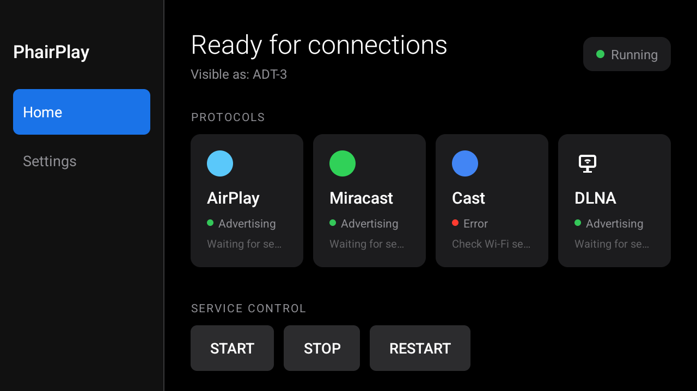

# 05. Post-root customization

Optional polish once the device is rooted, debloated and keystone-fixed: a rebuilt home screen, a consolidated settings app, boot logo and labels.

## 1. Custom home screen (launcher)

The home screen is a patch on top of [Gathin23/cleanyourtv](https://github.com/Gathin23/cleanyourtv) (`com.gathin.tvhome`, MIT). The patch and the modified files are in [`../launcher-mods`](../launcher-mods). It adds:

- **Weather** - keyless [Open-Meteo](https://open-meteo.com) (new `Weather.java`, needs the `INTERNET` permission; location in `strings.xml`, Budapest by default; refreshes every 30 minutes).
- **Second clock** - a home-country time zone (`vnClock`, `setTimeZone("Asia/Ho_Chi_Minh")`).
- **Lunar date** - Vietnamese lunisolar date and sexagenary year (built in; enabled via `lunar_date=true`, with the Can-Chi year on its own line).
- **Photo-frame screensaver** - `ClockScene.java` rewritten into a wallpaper slideshow (22-second cross-fade). Enabled via `clock_wallpaper=true` + `home_idle_clock_minutes=10`; shared by the system `ClockDream` and the home idle `ClockActivity`.
- **Three-column header** - Time / Date / Status, top-aligned, with the top-right buttons pinned to the top.

Apply it (see [`../launcher-mods/README.md`](../launcher-mods/README.md)): clone cleanyourtv, apply `hy300-home.patch` (or copy the files from `launcher-mods/src/`), then `JAVA_HOME=<jdk-22> sh ./gradlew assembleRelease` and `adb install -r app-release.apk`.

> Build note: on Windows, `cmd.exe /c gradlew.bat ...` does nothing here; use `sh ./gradlew assembleRelease`. The release build is debug-signed, so `adb install -r` overwrites cleanly.

### Screensaver behaviour on this firmware

`ClockDream` is already wired as the system screensaver (`settings secure screensaver_components=com.gathin.tvhome/.ClockDream`) and runs via `cmd dreams start-dreaming` (needs `su`). But the firmware's idle path just **powers the panel off**, and the Settings "Start now" button is broken (it sleeps instead of dreaming). Exiting a dream also blanks the panel; bring it back with `input keyevent KEYCODE_WAKEUP`. The launcher's own idle-clock (`home_idle_clock_minutes`) is the reliable path.

## 2. Hub app

[`../hub-app`](../hub-app) is `com.hy300.hub` ("Máy chiếu"): a single-screen launcher of tiles (Lucide-style icons) that consolidates the fragmented vendor settings - projector adjustment / keystone, casting, Wi-Fi, developer options, info. Non-exported targets are launched with a `su -c am start` fallback (grant the Hub root in Magisk once); `pkg` tiles need `QUERY_ALL_PACKAGES` to resolve on Android 11+. The casting tile opens the custom receiver (PhairPlay) rather than the stock cast page, which pushes a third-party app. Build with its own Gradle wrapper (`assembleDebug`).

The Hub also carries its own dark-Material **About screen** (`AboutActivity`) that replaces MagcubicOS's harsh blue one: the same device info in rounded cards, read from system properties and standard APIs, with no software-update rows. It is the first step of moving the user-facing settings onto a consistent Material surface (the vendor projector/keystone screens have no Android equivalent and stay as they are; generic ones like Wi-Fi/Bluetooth can deep-link to Android's own Material settings).

### Hiding the OTA update rows (no app patching)

MagcubicOS's About screen shows two update rows ("software update" and "online update") that launch the already-removed `com.htc.htcotaupdate` / `com.softwinner.update`. Rather than repackage the system settings app, hide them through its own config: the launcher reads `/oem/shortcuts.config` (a writable vfat, preferred over `/system/shortcuts.config`) as JSON, and each About row's visibility is a boolean there. Set `"updateFirmware": false` and `"onlineUpdate": false` (keep a `.bak`), then `am force-stop com.htc.magcubicos` to reload. The same file also filters apps from the launcher and the app manager.

### Dark-theming the vendor settings (no overlay, no repackage)

MagcubicOS's settings screens are a harsh royal blue. That blue is not a color resource an overlay could change: every screen extends `BaseActivity`, whose `setWallPaper()` draws one shared bitmap, `MyApplication.mainDrawable`, behind the content. `MyApplication` loads that bitmap at process start from `/data/user_de/0/com.htc.magcubicos/files/.wallpaper/background_main.png`. So dropping a dark 1280x720 PNG there recolors the entire vendor settings UI to a dark surface at once, with no RRO, no app repackaging and no re-signing (which would be unsafe on a platform-signed system app). [`../scripts/make-dark-wallpaper.py`](../scripts/make-dark-wallpaper.py) generates the image (standard library only) and prints the install commands; own it by the `com.htc.magcubicos` uid and `restorecon` it. The custom launcher is unaffected (it draws its own background). The separate `com.hysd.vafocus` keystone/focus screens have their own background and are not covered by this.

## 3. Force the custom launcher as HOME

The firmware **hard-forces `com.htc.magcubicos` as HOME** at boot (it ignores preferred activity, the HOME role, `persist.sys.homePackage`, and `pm disable`). Bring the custom launcher forward from the Magisk module in [`../magisk-module/hy300tweaks`](../magisk-module/hy300tweaks): its `service.sh` waits for `sys.boot_completed` then `am start`s the launcher (a short ~3-second flash of magcubicos is accepted).

## 4. Labels, timezone, boot logo

- **Model / names / timezone:** edit `/oem/customer.prop` (a writable vfat; keep a `.bak`): change `HY300Plus` to your name and set the timezone. (`persist.sys.tpryauto` also lives here.)
- **Boot logo:** replace `bootlogo.bmp` (1280x720, 24-bit) inside the `bootloader_a` FAT, and/or drop a `bootanimation.zip` into `/oem/media/`. Back up the stock BMPs first. The custom logo used here is [`../assets/logo.png`](../assets/logo.png).

## 5. Recommended apps (32-bit)

This SoC is 32-bit (`armeabi-v7a`); 64-bit-only APKs and the Play-certified YouTube TV will not install. Use:

- **[Aurora Store](https://f-droid.org/packages/com.aurora.store/)** - anonymous Play downloads (no Google account).
- **[SmartTube](https://github.com/yuliskov/SmartTube)** - ad-free YouTube; pick an AVC (H.264) <= 1080p preset to dodge slow VP9/AV1 software decode.
- **[Material Files](https://github.com/zhanghai/MaterialFiles)** - light FOSS file manager (replaces the adware stock / ES explorer).
- **Screen mirroring receiver** - if the stock AirPlay (`com.mphotool.airplay`) stays broken. Prefer a free, ad-free one: [PhairPlay](https://github.com/mazer666/PhairPlay) (AirPlay 2 / Miracast / DLNA; its APK ships `armeabi-v7a`, so it runs on this 32-bit SoC) or [iMirror](https://github.com/prat3ik/iMirror) (AirPlay only, more mature). Avoid AirScreen: it gates use behind a Pro-registration nag. For YouTube, do not cast at all; YouTube only casts to certified receivers, so watch it natively with SmartTube and its "Link with TV code" remote.

## 6. Screen mirroring (AirPlay) and the cast aspect fix

[PhairPlay](https://github.com/mazer666/PhairPlay) runs as a headless receiver; it is started at boot from the [hy300tweaks module](../magisk-module/hy300tweaks) (`service.sh`) so AirPlay is always available without opening the app.

One catch is specific to this SoC: an iPhone mirror came out **stretched horizontally**. The cause is the Allwinner hardware decoder, which scales a 1080-tall source down toward the 720p panel with unequal horizontal/vertical ratios and then reports a distorted crop rectangle (e.g. `484x712` for a true `498x1080` stream); PhairPlay trusted that crop and rendered the wrong aspect. The fix is a one-line change so the receiver keeps the true SPS-parsed size instead of the decoder's crop. Full diagnosis and the build recipe (apktool, local only, not redistributed) are in [`../scripts/phairplay-aspect-fix.md`](../scripts/phairplay-aspect-fix.md). The vendor HDMI-in aspect control, a separate lever, is in [`../scripts/SetAspect.java`](../scripts/SetAspect.java).

### Intermittent self-disconnects (Wi-Fi power save)

Casts also dropped at random and had to be re-started. The receiver's decode path is robust (it drops frames and resyncs rather than tearing down), so the drop comes from the data socket closing, i.e. the sender giving up. The cause is Wi-Fi power save: the **AIC8800** chip has `ps_on=Y` (and the module parameter is read-only at runtime, built into the kernel), while the receiver holds only an mDNS multicast lock, so during a stream the radio can nap and lose packets. The fix is to keep Wi-Fi awake: `cmd wifi force-low-latency-mode enabled` plus a `WIFI_MODE_FULL_LOW_LATENCY` lock held for as long as the device is up. [`../scripts/HoldWifiLock.java`](../scripts/HoldWifiLock.java) acquires that lock from a tiny root daemon (it gets a system `Context` via `ActivityThread`, so it needs no app), and the [hy300tweaks module](../magisk-module/hy300tweaks) starts both at boot and respawns the daemon if it exits. Harmless on a mains-powered projector. A cleaner long-term fix is for the receiver app to hold the lock itself only while a mirror session is active.

## 7. zram

Already enabled by the firmware (low-RAM device).
